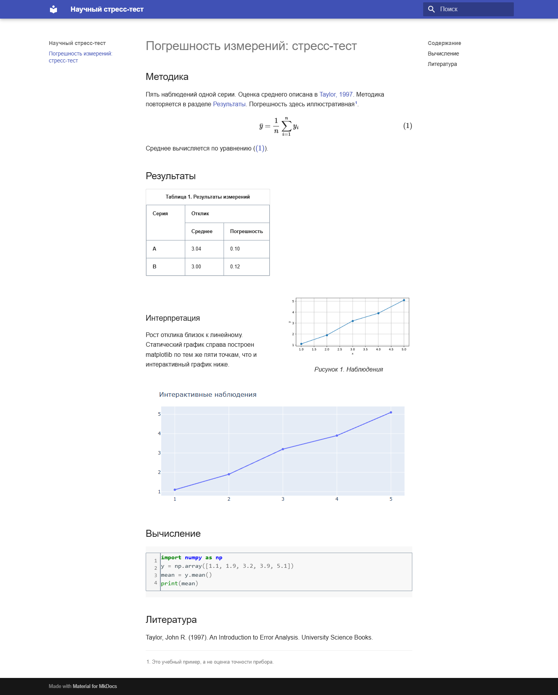
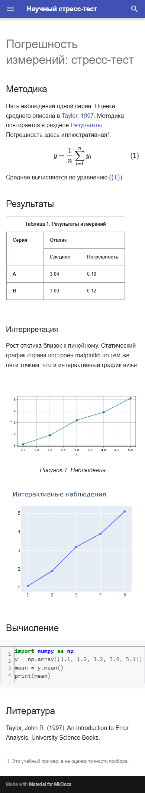
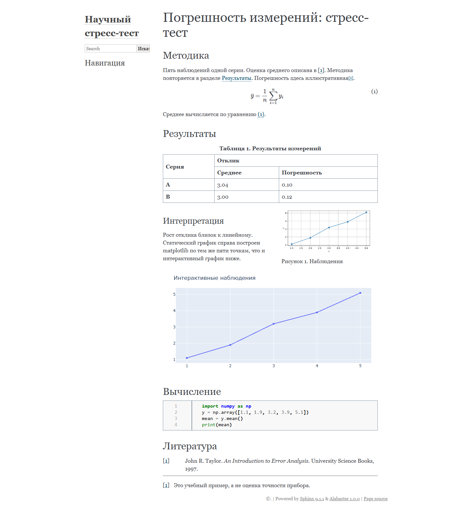
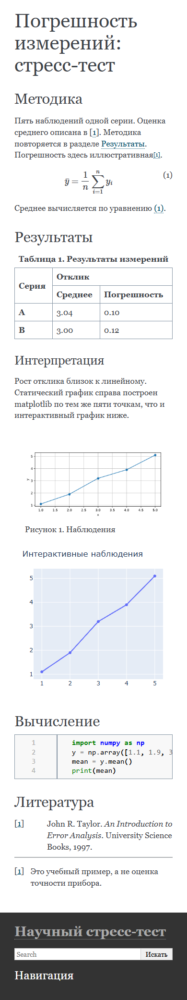
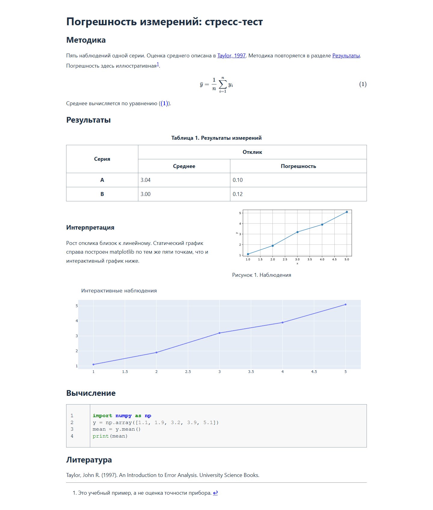
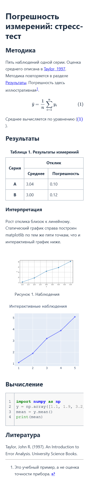

# P2. Измеренные результаты

Единица КБ = 1000 байт. Время — медиана трёх запусков. Подробный протокол и ограничения — в [REPORT.md](REPORT.md).

| Генератор | Чистая сборка, с | Повторная после правки, с | HTML, КБ | Ресурсы страницы desktop, КБ | Каталог сборки, КБ | Внешние запросы desktop/mobile | Lighthouse P/A/BP/SEO | Mobile 390px |
|---|---:|---:|---:|---:|---:|---|---|---|
| mkdocs | 1.631 | 1.768 | 23.3 | 6412.7 | 31511.5 | 0/0 | 66/90/100/91 | OK; grid 358px |
| sphinx | 4.482 | 13.176 | 15.5 | 6207.7 | 29235.1 | 0/0 | 63/93/96/91 | OK; grid 330px |
| pelican | 1.614 | 1.469 | 11.4 | 6090.3 | 28982.2 | 0/0 | 70/96/96/91 | OK; grid 342px |

P/A/BP/SEO: производительность, доступность, лучшие практики, поисковая оптимизация. Lighthouse не проверяет научную корректность. Mobile OK означает отсутствие горизонтального переполнения документа, ошибок JS/MathJax и сломанных изображений; визуальный просмотр дополняет эту проверку.

## Скриншоты

### mkdocs

### sphinx

### pelican

